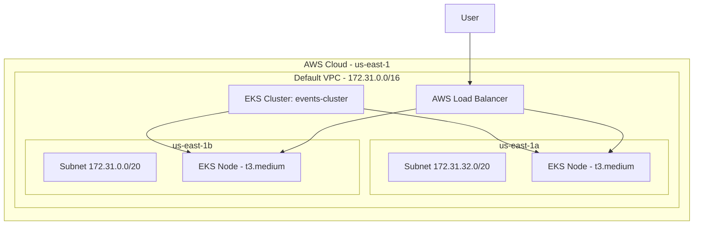

# eventsProject — Infrastructure & Deployment Guide

## Architecture Générale

```mermaid
flowchart LR
    A["Git Push"] --> B["Jenkins Pipeline"]
    B --> C["Maven Build & Test"]
    C --> D["SonarQube Analysis"]
    D --> E["Nexus Repository"]
    E --> F["Docker Build & Push"]
    F --> G["Docker Hub"]
    G --> H["Terraform IaC"]
    H --> I["AWS EKS Cluster"]
    I --> J["Kubernetes Deployment"]
    J --> K["Spring Boot App"]
```





## Prérequis Windows

| Outil | Version | Vérification |
|-------|---------|-------------|
| AWS CLI | v2+ | `aws --version` |
| Terraform | >= 1.5.0 | `terraform --version` |
| kubectl | v1.32+ | `kubectl version --client` |
| Docker Desktop | Latest | `docker --version` |
| Java JDK | 1.8 | `java -version` |
| Maven | 3.x | `mvn -version` |
| Git | Latest | `git --version` |

## Installation de Terraform

```powershell
# Option 1 : Chocolatey
choco install terraform

# Option 2 : Téléchargement manuel
# https://developer.hashicorp.com/terraform/downloads
# Extraire terraform.exe dans un dossier du PATH
```

## Installation et Configuration de kubectl

```powershell
# Option 1 : Chocolatey
choco install kubernetes-cli

# Option 2 : Via AWS CLI
aws eks update-kubeconfig --region us-east-1 --name events-cluster --profile terraform
```

## Configuration AWS CLI

```powershell
# Configurer le profil terraform
aws configure --profile terraform
# AWS Access Key ID: (depuis Vocareum)
# AWS Secret Access Key: (depuis Vocareum)
# Default region name: us-east-1
# Default output format: json

# Ajouter le session token (obligatoire pour AWS Academy)
aws configure set aws_session_token "VOTRE_TOKEN" --profile terraform

# Vérifier la configuration
aws sts get-caller-identity --profile terraform
```

> [!IMPORTANT]
> Les credentials AWS Academy **expirent** après chaque session Vocareum. Vous devrez les re-configurer à chaque nouvelle session.

## Rôles IAM Utilisés

Ces rôles sont pré-créés par AWS Academy. **Ne pas les modifier ou en créer de nouveaux.**

### Rôle du Cluster EKS
- **ARN :** `arn:aws:iam::228000713549:role/c231366a5819305l18006910t1w228000-LabEksClusterRole-FKw4SP1nvxL2`
- **Trust :** `eks.amazonaws.com`
- **Policies :** AmazonEKSClusterPolicy, AmazonEKSNetworkingPolicy, AmazonEKSComputePolicy, AmazonEKSBlockStoragePolicy, AmazonEKSLoadBalancingPolicy

### Rôle des Nœuds EKS
- **ARN :** `arn:aws:iam::228000713549:role/c231366a5819305l18006910t1w228000713-LabEksNodeRole-5qPX0IPXdKCx`
- **Trust :** `ec2.amazonaws.com`
- **Policies :** AmazonEKSWorkerNodePolicy, AmazonEKS_CNI_Policy, AmazonEC2ContainerRegistryReadOnly

### Rôle voclabs
- **ARN :** `arn:aws:iam::228000713549:role/voclabs`
- Rôle utilisé par AWS Academy pour l'accès utilisateur. Configuré comme admin du cluster EKS.

## Terraform — Fonctionnement

### Structure des fichiers

```
terraform/
├── .gitignore              # Exclut .terraform/, tfstate, tfvars
├── versions.tf             # Versions Terraform et providers
├── providers.tf            # Configuration du provider AWS
├── variables.tf            # Variables d'entrée
├── network.tf              # Data sources VPC, tags subnets, security group
├── eks.tf                  # Cluster EKS, access entries, node group
├── outputs.tf              # Outputs (cluster info, kubeconfig cmd)
├── terraform.tfvars        # Valeurs des variables (ne pas committer)
└── terraform.tfvars.example # Exemple de configuration
```

### Décisions d'architecture

| Décision | Justification |
|----------|--------------|
| Réutilisation du VPC par défaut | Évite les coûts et complexité d'un VPC dédié |
| Sous-réseaux publics uniquement | Évite le coût d'un NAT Gateway (~\$32/mois) |
| 2 AZ (us-east-1a, us-east-1b) | Haute disponibilité minimale requise par EKS |
| t3.medium (2 vCPU, 4 GB) | Minimum recommandé pour EKS worker nodes |
| 2 nœuds (min 1, max 3) | Suffisant pour un projet académique |
| Disque 20 GB | Minimum pour les images Docker |
| Kubernetes 1.32 | Dernière version stable vérifiée compatible |
| Pas de NAT Gateway | Économie ~\$32/mois |
| LoadBalancer Service | Accès externe à l'application |

### Commandes Terraform

```powershell
cd terraform

# Initialiser (télécharge les providers)
terraform init

# Vérifier le formatage
terraform fmt -check -recursive

# Valider la configuration
terraform validate

# Prévisualiser les changements
terraform plan

# Appliquer (UNIQUEMENT après validation du plan)
terraform apply

# Voir les outputs
terraform output
```

## Déploiement Kubernetes

### Structure des manifests

```
k8s/
├── namespace.yaml          # Namespace events-project
├── configmap.yaml          # Configuration Spring Boot
├── secret.yaml             # Credentials DB (template)
├── mysql-deployment.yaml   # MySQL Deployment + Service
├── deployment.yaml         # App Deployment (IMAGE_PLACEHOLDER)
├── service.yaml            # LoadBalancer Service
└── README.md               # Documentation K8s
```

### Déploiement manuel

```powershell
# 1. Configurer kubectl
aws eks update-kubeconfig --region us-east-1 --name events-cluster --profile terraform

# 2. Vérifier les nœuds
kubectl get nodes

# 3. Déployer dans l'ordre
kubectl apply -f k8s/namespace.yaml
kubectl apply -f k8s/configmap.yaml
kubectl apply -f k8s/secret.yaml
kubectl apply -f k8s/mysql-deployment.yaml

# 4. Remplacer IMAGE_PLACEHOLDER et déployer l'app
# (Le Jenkinsfile fait cela automatiquement)
kubectl apply -f k8s/deployment.yaml
kubectl apply -f k8s/service.yaml

# 5. Vérifier
kubectl get pods -n events-project
kubectl get services -n events-project
```

## Pipeline Jenkins — 12 Étapes

| Stage | Description | Outils |
|-------|------------|--------|
| 1 | Git Checkout | Git |
| 2 | Verify Tools | Git, Maven, Java, Docker |
| 3 | Build and Test | Maven (`clean verify`) |
| 4 | Archive JAR | Jenkins Artifacts |
| 5 | SonarQube Analysis | SonarQube |
| 6 | Publish to Nexus | Maven + Nexus |
| 7 | Download JAR from Nexus | PowerShell + REST API |
| 8 | Docker Build & Push | Docker Hub |
| 9 | Terraform Init & Validate | Terraform |
| 10 | Terraform Apply | Terraform |
| 11 | Configure Kubernetes | AWS CLI + kubectl |
| 12 | Kubernetes Deployment | kubectl |

### Credentials Jenkins nécessaires

| Credential ID | Type | Description |
|--------------|------|-------------|
| `nexus_secret` | Username/Password | ✅ Existant — Nexus |
| `dockerhub_credentials` | Username/Password | ✅ Existant — Docker Hub |
| `aws_access_key_id` | Secret Text | 🆕 À créer — AWS Access Key |
| `aws_secret_access_key` | Secret Text | 🆕 À créer — AWS Secret Key |
| `aws_session_token` | Secret Text | 🆕 À créer — AWS Session Token |

### Configuration des Credentials AWS dans Jenkins

1. **Jenkins → Manage Jenkins → Credentials → System → Global**
2. Ajouter 3 credentials de type **Secret text** :
   - ID: `aws_access_key_id` → Valeur: votre AWS_ACCESS_KEY_ID
   - ID: `aws_secret_access_key` → Valeur: votre AWS_SECRET_ACCESS_KEY
   - ID: `aws_session_token` → Valeur: votre AWS_SESSION_TOKEN
3. Les valeurs se trouvent dans la page **AWS Details** de Vocareum

> [!WARNING]
> Ces credentials doivent être mis à jour à chaque nouvelle session Vocareum car ils expirent.

### Outils requis sur le serveur Jenkins

- Terraform installé et dans le PATH
- kubectl installé et dans le PATH
- AWS CLI installé et dans le PATH
- Docker Desktop fonctionnel

## Commandes de Vérification

```powershell
# AWS
aws sts get-caller-identity --profile terraform
aws eks describe-cluster --name events-cluster --profile terraform --region us-east-1

# Terraform
cd terraform
terraform show
terraform output

# Kubernetes
kubectl get nodes
kubectl get all -n events-project
kubectl get pods -n events-project -o wide
kubectl get svc events-project-service -n events-project
kubectl logs -n events-project -l app=events-project --tail=50

# URL de l'application
kubectl get svc events-project-service -n events-project -o jsonpath="{.status.loadBalancer.ingress[0].hostname}"
```

## Erreurs Fréquentes et Solutions

### 1. `AccessDenied` lors de `terraform apply`
**Cause :** Credentials AWS expirés.
**Solution :** Relancer la session Vocareum et mettre à jour les credentials.

### 2. `ResourceNotFoundException: No cluster found`
**Cause :** Le cluster n'a pas encore été créé ou la région est incorrecte.
**Solution :** Vérifier avec `terraform output cluster_name` et s'assurer que la région est `us-east-1`.

### 3. `error: You must be logged in to the server`
**Cause :** kubeconfig non configuré ou credentials expirés.
**Solution :**
```powershell
aws eks update-kubeconfig --region us-east-1 --name events-cluster --profile terraform
```

### 4. `CreateCluster: AccessDeniedException`
**Cause :** Le rôle voclabs n'a pas la permission `eks:CreateCluster`.
**Solution :** Vérifier les permissions dans AWS Academy. Cette permission est normalement incluse.

### 5. `Nodes not ready`
**Cause :** Le node group est en cours de provisionnement.
**Solution :** Attendre 5-10 minutes, le provisionnement EKS prend du temps.

### 6. `ImagePullBackOff`
**Cause :** L'image Docker Hub n'est pas accessible ou n'existe pas.
**Solution :** Vérifier que le Docker Build & Push (stage 8) a réussi et que l'image existe sur Docker Hub.

### 7. `Pods en CrashLoopBackOff`
**Cause :** L'application ne démarre pas (problème de connexion DB, configuration, etc.)
**Solution :**
```powershell
kubectl logs -n events-project -l app=events-project
kubectl describe pod -n events-project -l app=events-project
```

### 8. `terraform init` très lent
**Cause :** Téléchargement du provider AWS (~300 MB).
**Solution :** Normal la première fois. Les exécutions suivantes utilisent le cache.

## Suppression Contrôlée de l'Infrastructure

> [!CAUTION]
> **Ne JAMAIS exécuter `terraform destroy` automatiquement.** Toujours vérifier le plan de destruction avant.

```powershell
# 1. Supprimer les ressources Kubernetes d'abord
kubectl delete namespace events-project

# 2. Vérifier ce qui sera détruit
cd terraform
terraform plan -destroy

# 3. Détruire l'infrastructure (APRÈS VALIDATION)
terraform destroy
```

### Ressources qui seront supprimées :
- Cluster EKS `events-cluster`
- Node Group `events-nodes`
- Security Group `events-cluster-sg`
- Tags EKS sur les subnets

### Ressources qui ne seront PAS supprimées :
- VPC par défaut (non géré par Terraform)
- Subnets par défaut (seuls les tags sont supprimés)
- Rôles IAM (non gérés par Terraform)
- Images Docker Hub

## Estimation des Coûts

| Ressource | Coût estimé |
|-----------|-------------|
| EKS Control Plane | ~\$0.10/h (\$72/mois) |
| 2x t3.medium (On-Demand) | ~\$0.083/h × 2 = \$0.17/h (\$120/mois) |
| EBS (20 GB × 2 nodes) | ~\$3.20/mois |
| Load Balancer (Classic) | ~\$0.025/h (\$18/mois) |
| **Total estimé** | **~\$0.30/h (~\$213/mois)** |

> [!TIP]
> Pour un projet académique, **détruisez l'infrastructure** après chaque session de travail avec `terraform destroy` pour minimiser les coûts. AWS Academy fournit des crédits limités.

