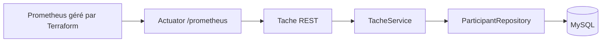

# Architecture constatée

Spring Boot 2.7.6 / Java cible 8 / Maven / Spring MVC / Spring Data JPA / MySQL.
Package : src/main/java/tn/esprit/eventsproject.
EventRestController -> IEventServices / EventServicesImpl -> trois JpaRepository.
Entités persistantes : Participant, Event, Logistics. Tache est un enum stocké
en chaîne dans Participant.tache. Aucune entite Tache autonome ; DTOs de creation et service de roles ajoutes.
Le calcul planifié des coûts filtre les participants ORGANISATEUR.
Logging actuel : SLF4J via Lombok, backend Log4j2 (Logback exclu du POM).
PerformanceAspect mesure les appels services. Application : port 8089, contexte /events.
Base configurée : eventsProject sur localhost:3306, utilisateur root, mot de passe vide.

Contribution ajoutée : TacheRestController -> TacheService -> ParticipantRepository.
DTO limité à participantId/tache ; transactions et erreurs HTTP limitées à ce module.
Profil local -> MySQL Compose sur 3307 ; déploiement Docker vérifié avec runtime Java 17.
Kubernetes kind 1.32.2 : namespace events-tache, application et MySQL prêts, PVC MySQL.
Terraform : namespace events-monitoring, quota, ConfigMap, PVC, Deployment et Service
Prometheus. Apply approuvé et vérifié ; scrape Actuator UP.
Jenkins #4 orchestre tests, Sonar/gate, Nexus, image et livraison kind.
Grafana provisionne quatre panneaux Prometheus dans events-grafana.
Docker Hub public autorise pour ayyoub1/events-tache ; publication en cours.

